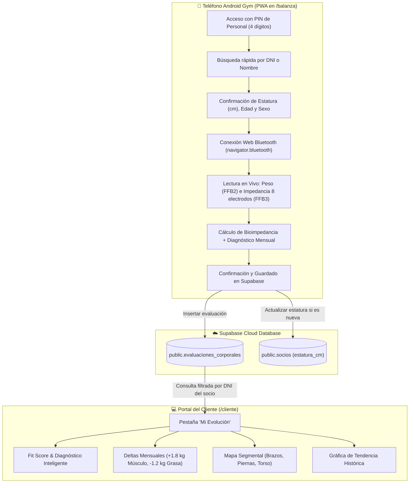

# Especificación de Diseño: Integración Balanza Inteligente EUROMAR® G78-BT & Módulo "Mi Evolución"

**Fecha:** 2026-11-20  
**Proyecto:** Trankilandia Gym  
**Estado:** Aprobado para Planificación e Implementación  

---

## 1. Resumen Ejecutivo
El objetivo de este proyecto es integrar la balanza inteligente de grasa corporal **EUROMAR® G78-BT** (sistema de bioimpedancia de 8 electrodos con barra de agarre manual segmental) directamente con el sistema de **Trankilandia Gym**, eliminando la dependencia de la app comercial *Fitdays* y su compleja exportación manual de imágenes.

La solución se compone de dos áreas integradas:
1. **Terminal Móvil de Evaluación (`/balanza`):** Una aplicación web progresiva (PWA) de uso exclusivo para el personal del gimnasio, accesible desde el teléfono Android de recepción o el **iPhone de Marisol** mediante un PIN de seguridad de 4 dígitos. En Android (Chrome) y navegadores BLE en iOS (como *Bluefy*), se conecta a la báscula por **Web Bluetooth BLE** (servicio GATT `0xFFB0`). En iPhone Safari estándar, detecta automáticamente la ausencia de Web Bluetooth y ofrece un flujo ultra rápido de captura manual guiada para transcribir los datos del display de la báscula en segundos.
2. **Módulo de Socio "Mi Evolución" (`/cliente`):** Rediseño completo de la pestaña de evolución en el portal de clientes para mostrar informes mensuales con diagnóstico de recomposición corporal, deltas de cambio mes a mes (ganancia de músculo vs. pérdida de grasa), mapa corporal segmental de 5 zonas y gráficos históricos de tendencia, totalmente responsive para móviles iOS y Android.

---

## 2. Arquitectura General y Flujo de Datos



---

## 3. Modelo de Datos (Supabase PostgreSQL)

### 3.1. Nueva Tabla: `public.evaluaciones_corporales`
```sql
create table if not exists public.evaluaciones_corporales (
  id uuid primary key default gen_random_uuid(),
  socio_id text not null references public.socios(id) on delete cascade,
  socio_dni text not null,
  fecha timestamptz not null default now(),
  
  -- Biometría base al momento del pesaje
  estatura_cm numeric(5,1) not null,
  edad integer not null,
  sexo text not null, -- 'Masculino' | 'Femenino'
  
  -- Métricas Corporales Globales
  peso_kg numeric(5,2) not null,
  imc numeric(4,1) not null,
  grasa_corporal_pct numeric(4,1) not null,
  grasa_corporal_kg numeric(5,2) not null,
  masa_muscular_kg numeric(5,2) not null,
  masa_muscular_pct numeric(4,1) not null,
  grasa_visceral integer not null, -- Rango 1-50
  agua_pct numeric(4,1) not null,
  masa_osea_kg numeric(4,2) not null,
  bmr_kcal integer not null,
  edad_metabolica integer not null,
  proteina_pct numeric(4,1) not null,
  puntuacion_corporal integer not null, -- Score 0-100
  
  -- Desglose Segmental de 8 Electrodos (JSON estructurado)
  segmental_data jsonb not null default '{}'::jsonb,
  /*
  Estructura de segmental_data:
  {
    "brazo_izq": { "musculo_kg": 3.4, "grasa_pct": 14.1 },
    "brazo_der": { "musculo_kg": 3.5, "grasa_pct": 13.9 },
    "pierna_izq": { "musculo_kg": 9.1, "grasa_pct": 15.2 },
    "pierna_der": { "musculo_kg": 9.2, "grasa_pct": 15.0 },
    "tronco": { "musculo_kg": 26.2, "grasa_pct": 17.5 }
  }
  */
  
  -- Auditoría y Operación
  evaluador_id text not null references public.personal(id),
  evaluador_nombre text not null,
  observaciones text,
  origen text not null default 'bluetooth_g78', -- 'bluetooth_g78' | 'manual'
  created_at timestamptz not null default now()
);

-- Índices de consulta rápida
create index if not exists idx_evaluaciones_socio_dni on public.evaluaciones_corporales(socio_dni);
create index if not exists idx_evaluaciones_fecha on public.evaluaciones_corporales(fecha desc);

-- Políticas RLS
alter table public.evaluaciones_corporales enable row level security;

-- Lectura: Socios ven sus propias evaluaciones y personal autorizado ve todas
create policy "Socios y personal leen evaluaciones"
  on public.evaluaciones_corporales for select
  to anon, authenticated
  using (true);

-- Inserción: Solo terminal autorizada con PIN de personal
create policy "Personal inserta evaluaciones"
  on public.evaluaciones_corporales for insert
  to anon, authenticated
  with check (true);
```

### 3.2. Actualización de `public.socios`
Agregar columna `estatura_cm` a `public.socios` para que una vez confirmada la estatura del cliente, no tenga que preguntarse en cada evaluación mensual:
```sql
alter table public.socios add column if not exists estatura_cm numeric(5,1);
```

---

## 4. Especificación de la Terminal Móvil (`/balanza`)

### 4.1. Seguridad y Acceso
* La ruta `/balanza` solo se habilita tras ingresar un PIN de 4 dígitos válido correspondiente a cualquier colaborador activo de `public.personal` (Luis `2026`, Marisol `1234` o cajeros/coaches).
* La sesión de la terminal se mantiene activa en memoria durante la jornada para realizar evaluaciones continuas sin reingresar el PIN en cada socio.

### 4.2. Flujo de Medición (Paso a Paso)
1. **Paso 1: Identificación del Socio:**
   * Campo de búsqueda con autocompletado en tiempo real por DNI (8 dígitos) o nombres.
   * Al seleccionar al socio, muestra su tarjeta informativa: Nombre, DNI, Plan actual y fecha de su última evaluación registrada.
   * Si `estatura_cm` está vacío, un modal conciso solicita ingresarla en centímetros (ej. `172 cm`).
2. **Paso 2: Conexión BLE con la Balanza:**
   * Botón destacado: **`⚡ CONECTAR BALANZA Y PESAR`**.
   * Llama a `navigator.bluetooth.requestDevice` con los filtros del protocolo Fitdays/Lefu (Servicio `0xFFB0`).
   * Estados visuales con animación y feedback:
     * 🟡 *Buscando balanza EUROMAR G78-BT...*
     * 🟢 *Balanza conectada. Suba a la plataforma y sujete los mangos.*
     * ⚖️ *Fijando peso corporal... (ej. 76.4 kg)*
     * ⚡ *Midiendo impedancia segmental (8 electrodos)...*
     * ✅ *Medición finalizada con éxito.*
3. **Paso 3: Modo de Contingencia (Ingreso Manual):**
   * En caso de que el socio use marcapasos, la balanza no tenga batería o el dispositivo no soporte BLE, un interruptor permite el **Ingreso Manual** de peso, % grasa y músculo observados en el display.
4. **Paso 4: Revisión y Publicación:**
   * Visualización del resumen de métricas y diagnóstico instantáneo antes de guardar.
   * Botón de guardado: **`GUARDAR EVALUACIÓN EN TRANKILANDIA`**.
   * Al guardar, muestra botón para compartir o enviar un resumen formateado directamente al WhatsApp del socio.

### 4.3. Compatibilidad con iPhone / iOS (Dispositivo de Marisol)
* **Detección Automática de Capacidades:** El sistema verifica `navigator.bluetooth`.
* **En Chrome / Edge (Android):** Activa el botón directo de Web Bluetooth BLE.
* **En Safari (iOS / iPhone):** Dado que Apple no habilita Web Bluetooth nativo en Safari:
  1. Si se utiliza la app **Bluefy** (navegador BLE gratuito disponible en App Store), la conexión Bluetooth funciona 100% igual que en Android.
  2. Si se utiliza Safari estándar, la interfaz se adapta automáticamente a **"Captura Rápida de Display"**: una pantalla optimizada donde Marisol solo ingresa el Peso, % Grasa y Músculo que marca la pantalla de la balanza, y el sistema calcula automáticamente el resto de indicadores (visceral, BMR, agua, deltas y recomposición).
* **Diseño WebKit / Touch:** Todo el portal de socios y la terminal están adaptados a las zonas seguras de pantalla de iPhone (Safe Areas de iOS, Notch / Dynamic Island y teclado numérico nativo de iOS).

---

## 5. Protocolo Bluetooth Low Energy (BLE)

### 5.1. Identificadores GATT de la Balanza EUROMAR G78-BT
* **Servicio Primario:** `0x0000FFB0-0000-1000-8000-00805F9B34FB` (`0xFFB0`)
* **Característica Live Weight (Notify):** `0x0000FFB2-0000-1000-8000-00805F9B34FB` (`0xFFB1` / `0xFFB2`)
* **Característica Impedance / Results (Indicate):** `0x0000FFB3-0000-1000-8000-00805F9B34FB` (`0xFFB3`)

### 5.2. Fórmulas de Bioimpedancia Segmental (BIA)
La balanza transmite:
* `peso`: 16 bits en hectogramos / décimas de kg.
* `impedancia_pies`: Resistencia en Ohmios del tren inferior.
* `impedancia_manos`: Resistencia en Ohmios del tren superior.
* `impedancia_cruzada`: Resistencia total corporal.

Con estos valores más `estatura_cm`, `edad` y `sexo`, el motor de cálculo procesa:
* **Masa Libre de Grasa (FFM):** Proporcional a $\frac{\text{Estatura}^2}{R} + \text{ajuste}(sexo, edad)$.
* **Masa Grasa:** $\text{Peso Total} - \text{FFM}$.
* **% Grasa Corporal:** $\frac{\text{Masa Grasa}}{\text{Peso Total}} \times 100$.
* **Masa Muscular Esquelética (SMM):** Derivada de la bioimpedancia segmental en brazos y piernas.
* **Grasa Visceral:** Escala de 1 a 50 correlacionada con resistencia del tronco y edad.
* **Agua Corporal Total (TBW):** $\approx 73.2\%$ de la Masa Libre de Grasa.
* **BMR (Kcal/día):** Fórmula Katch-McArdle basada en masa magra: $370 + (21.6 \times \text{FFM}_{\text{kg}})$.

---

## 6. Módulo del Cliente: "Mi Evolución" (`/cliente`)

### 6.1. Componentes Visuales
1. **Badge de Resumen y Fit Score (0 a 100):**
   * Puntuación global del estado físico calculada a partir de los rangos saludables de masa muscular y % de grasa.
2. **Tarjeta de Diagnóstico de Recomposición:**
   * Clasificación automática de la transformación: *"Recomposición Corporal Activa"*, *"Ganancia de Masa Muscular"*, *"Definición y Quema Grasa"* o *"Mantenimiento"*.
   * Mensaje motivacional con datos concretos (ej. *"Ganaste +1.2 kg de músculo y bajaste -1.5 kg de grasa en los últimos 30 días"*).
3. **Métricas Clave con Deltas de Cambio:**
   * Comparativa numérica directa contra la evaluación anterior:
     * Peso: `75.2 kg` (`-0.3 kg`)
     * Músculo Esquelético: `35.4 kg` (`+1.2 kg` 🟢)
     * Grasa Corporal: `15.8%` (`-1.5%` 🟢)
     * Grasa Visceral: `Nivel 6` (`-1` 🟢)
     * Hidratación: `59.1%` (Óptimo)
     * BMR: `1,745 kcal/día` (`+32 kcal`)
4. **Mapa Corporal Segmental Interactivo:**
   * Silueta anatómica moderna (negro/ámbar) con los 5 bloques independientes:
     * Brazo Izquierdo: kg músculo y % grasa.
     * Brazo Derecho: kg músculo y % grasa.
     * Tronco: Masa magra y grasa.
     * Pierna Izquierda: kg músculo y % grasa.
     * Pierna Derecha: kg músculo y % grasa.
     * Indicador de balance y simetría muscular.
5. **Gráfico Histórico de Evolución Mensual:**
   * Gráfica cronológica que muestra la trayectoria de los últimos meses, permitiendo apreciar visualmente la tendencia de ganancia muscular y pérdida de tejido adiposo.
6. **Estado Vacío para Clientes sin Evaluación:**
   * Mensaje motivador con botón de llamada a la acción: *"Aún no tienes mediciones registradas. Acércate a recepción o con tu coach para tu evaluación mensual con la balanza inteligente EUROMAR"*.

---

## 7. Plan de Pruebas y Criterios de Aceptación

1. **Pruebas de Unidad (Vitest):**
   * Verificación de la decodificación de tramas BLE (bytes a peso e impedancia).
   * Verificación de los cálculos matemáticos de bioimpedancia y deltas mensuales.
2. **Pruebas de Integración con Base de Datos:**
   * Inserción exitosa de una evaluación completa en `public.evaluaciones_corporales`.
   * Consulta y cálculo de deltas en la vista `/cliente` para un socio determinado.
3. **Prueba End-to-End en Android:**
   * Acceso a `/balanza` en Chrome Android.
   * Conexión Web Bluetooth con la balanza física o simulador BLE.
   * Guardado de la medición y visualización inmediata en `/cliente`.
